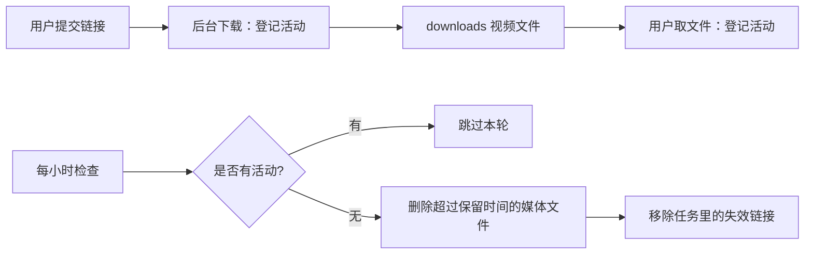
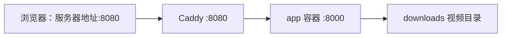

# 个人视频下载工具

一个支持 **抖音** 与 **B 站（bilibili）** 无水印视频下载的工具，提供命令行（CLI）与 Web 两种使用方式。

- 抖音：使用 Playwright 驱动系统自带的 Edge 浏览器拦截详情接口，绕过反爬签名，直接获取无水印直链下载。
- B 站：纯 `requests` + wbi 签名，无需浏览器，支持多分 P 与 1080P 高清（需登录态 + ffmpeg）。
- Web：基于 FastAPI 的轻量页面，用于提交链接并查看下载任务。

---

## 功能特性

### 抖音（downloader.py）
- 无水印视频下载（自动避开带 `watermark=1` 的 `download_addr`，只取 `play_addr` 系）。
- 支持多种输入格式：分享链接、口令文本、纯视频 ID（15~20 位数字）。
- 短链（`v.douyin.com`）自动跳转解析。
- 失败时可自动用 **yt-dlp** 兜底，支持从浏览器读取 cookie（`edge` / `chrome`）。

### B 站（bilibili.py）
- 解析 BV 号 / av 号 / b23.tv 短链 / 完整链接。
- 获取标题、UP 主、分 P 列表，支持按页码下载指定分 P 或全部。
- 默认下载 ≤720P 的 mp4 直链（单文件，无需 ffmpeg）。
- `--hd` 下载 1080P（DASH 音视频分离，ffmpeg 合并，需登录 cookie + ffmpeg）。

### Web（app/）
- FastAPI 服务，提供首页、静态资源与下载文件目录访问。
- 完整下载任务 API：创建任务、查询单个任务状态/进度/日志、列出所有任务。
- 后台线程异步执行下载，进度与日志实时回写内存任务仓库。

---

## 目录结构

```
dyonline/
├── app/
│   ├── __init__.py       # 包标记
│   ├── main.py           # FastAPI 应用入口
│   └── task_store.py     # 下载任务仓库（内存版）
├── static/
│   └── style.css         # 前端样式
├── templates/
│   └── index.html        # 首页模板
├── downloads/            # 下载文件保存目录（运行时自动创建）
├── bilibili.py           # B 站下载模块
├── downloader.py         # 抖音下载 + CLI 入口
├── requirements.txt      # Python 依赖清单
└── README.md
```

---

## 环境要求

- **Python** 3.10+
- **浏览器**：Windows 默认 Edge；Linux 容器默认 Playwright Chromium。可用 `DOUYIN_BROWSER_CHANNEL` 指定。
- **ffmpeg**（仅 B 站 1080P 高清下载需要，需加入系统 PATH）

---

## 安装

```bash
# 1. （推荐）创建并激活虚拟环境
python -m venv .venv
.venv\Scripts\activate        # Windows

# 2. 安装依赖
pip install -r requirements.txt

# 3. 安装 Playwright 浏览器驱动（使用系统 Edge 时无需下载 chromium）
playwright install msedge
```

> `requirements.txt` 内容：`fastapi`、`uvicorn[standard]`、`jinja2`、`requests`、`playwright`、`yt-dlp`。

---

## 使用方法

### 方式一：命令行（CLI）

```bash
python downloader.py "分享链接或口令"
```

支持一次传入多个链接（自动区分抖音与 B 站）：

```bash
python downloader.py -o D:/downloads "链接1" "链接2" ...
```

**抖音相关参数：**

```bash
# 失败时用 yt-dlp 从 Edge 读取 cookie 兜底
python downloader.py --cookies-from-browser edge "链接"

# 强制使用 yt-dlp 下载
python downloader.py --yt-dlp --cookies-from-browser edge "链接"
```

**B 站相关参数：**

```bash
# 下载指定分 P（页码，从 1 开始）或 ALL（全部）
python downloader.py --p 2 "BV1xxxx"

# 下载 1080P 高清（需登录 cookie + 本机安装 ffmpeg）
python downloader.py --hd --cookie "SESSDATA=xxx" "BV1xxxx"
```

完整参数列表：

| 参数 | 说明 |
|------|------|
| `links` | 分享链接/口令，可一次给多个 |
| `-o, --output` | 保存目录（默认当前目录） |
| `--cookies-from-browser` | 抖音失败时用 yt-dlp 从浏览器读 cookie 兜底（如 `edge`/`chrome`） |
| `--yt-dlp` | 抖音强制使用 yt-dlp 下载 |
| `--p` | B 站：选择分 P（页码数字或 `ALL`，默认全部） |
| `--hd` | B 站：下载 1080P 高清（DASH + ffmpeg） |
| `--cookie` | B 站：传登录 Cookie（如 `SESSDATA=xxx`） |

---

### 方式二：Web 服务

**一键启动（推荐）**：直接双击根目录的 `start.bat`，脚本会自动完成「创建虚拟环境 → 安装依赖 → 启动服务 → 打开浏览器」，无需手动敲命令。

手动启动：

```bash
uvicorn app.main:app --reload
```

浏览器访问：<http://127.0.0.1:8000>

首页提供链接输入框（每行一个链接），提交后创建后台下载任务，并实时显示进度条、日志与下载完成的文件链接；下载文件通过 `/files` 路径访问。

### HTTP 接口

| 方法 | 路径 | 说明 |
|------|------|------|
| `GET` | `/` | 首页 |
| `POST` | `/api/tasks` | 创建下载任务，请求体 `{"links": ["链接1", "链接2"]}` |
| `GET` | `/api/tasks` | 列出所有任务 |
| `GET` | `/api/tasks/{task_id}` | 查询单个任务的进度、日志、文件 |
| `GET` | `/files/{filename}` | 下载已保存的视频文件 |

---

## 实现原理

### 抖音
1. 解析分享链接/口令，提取 `aweme_id`。
2. Playwright 无头启动浏览器打开作品页，收到页面响应后独立等待视频数据；遇到登录或验证码时可能失败。
3. 拦截详情接口 `/aweme/v1/web/aweme/detail/` 的响应，从 `aweme_detail.video.play_addr.url_list` 取无水印直链。
4. 用 `requests` 带 `Referer` 流式下载到本地。

### B 站
1. 解析 BV/av 号（b23.tv 短链自动跳转）。
2. `view` 接口获取标题、UP 主、分 P 列表（每 P 的 cid）。
3. `playurl` 接口（wbi 签名）获取播放地址：
   - 默认（≤720P）：`fnval=0` 返回 `durl` → mp4 单文件直链，直接下载。
   - `--hd`（1080P）：`fnval=16` 返回 `dash`（音视频分离）→ ffmpeg 合并。

---

## 注意事项

- 本工具仅供个人学习、研究及备份自己拥有权限的内容使用，请遵守目标平台的服务条款与当地法律法规，勿用于任何商业或侵权用途。
- 抖音下载依赖系统 Edge 浏览器，首次使用请确保已安装 Edge。
- B 站 1080P 高清下载需登录 Cookie（`SESSDATA` 等）且本机已安装 ffmpeg。
- 下载的文件统一保存在 `downloads/` 目录（或 `-o` 指定的目录），同名文件会自动跳过。


## 服务器视频定期清理

Web 服务默认保留下载文件 **24 小时**，**每小时检查一次**，第一次检查在启动一小时后进行。
年龄按文件最后修改时间计算，所以重启后仍能清理之前留下的视频和失败下载的媒体临时文件。
实际删除可能比保留时间晚一个检查周期；有后台下载或 `/files/` 文件传输时，本轮跳过，下轮重试。
清理仅针对 `downloads/` 顶层的 `.mp4`、`.m4s`、`.webm`、`.m4a`、`.part`、`.ytdl` 文件，
不递归删除目录，不跟随符号链接，不清理其他扩展名。
任务记录和日志保留；已删除文件的链接从 API 返回中移除，已打开的页面需要刷新。

| 环境变量 | 默认值 | 作用 |
|---|---|---|
| `DOWNLOAD_RETENTION_HOURS` | `24` | 非负整数小时；`0` 关闭自动清理 |
| `DOWNLOAD_CLEANUP_INTERVAL_SECONDS` | `3600` | 正整数秒，控制检查间隔 |

Linux 启动示例（保留 48 小时）：

```bash
DOWNLOAD_RETENTION_HOURS=48 DOWNLOAD_CLEANUP_INTERVAL_SECONDS=3600 \
uvicorn app.main:app --host 127.0.0.1 --port 8000 --workers 1
```

目前任务仓库和清理保护都在进程内，服务器使用 **一个 worker、一个应用实例**。
多个实例或 CLI 不应同时向这个受清理的目录写文件。清理由应用自行调度，无需额外安装 cron。
Caddy 应将 `/files/*` 也反向代理给本应用，避免直接读取下载目录而绕过传输保护。




## Caddy：8080 对外，代理 app 容器的 8000

仓库的 `Caddyfile` 内容如下：

```caddyfile
:8080 {
    reverse_proxy app:8000
}
```

- `:8080`：Caddy 在 8080 端口接收 HTTP 请求。
- `reverse_proxy app:8000`：将所有路径（首页、API、静态资源、视频文件）转发给 `app` 容器的 8000 端口。
- Caddy 容器与 `app` 容器必须连接同一个 Docker 网络，`app` 为服务名或网络别名。
- app 容器内启动命令：`uvicorn app.main:app --host 0.0.0.0 --port 8000 --workers 1`。
- Caddy 容器端口映射：`8080:8080`；将此文件挂载到 `/etc/caddy/Caddyfile`。
- app 的 8000 端口供容器网络访问，无需映射到公网。
- 在 app 容器设置上述清理环境变量，并确保挂载的下载目录允许应用删除文件。

若 Caddy 运行在宿主机上，则将 app 的端口映射为 `127.0.0.1:8000:8000`，
并将代理目标改为 `127.0.0.1:8000`。

更新服务器配置前可在 Caddy 容器运行：

```bash
caddy validate --config /etc/caddy/Caddyfile --adapter caddyfile
caddy reload --config /etc/caddy/Caddyfile --adapter caddyfile
```

本仓库原先没有 Docker 部署文件；这里提供代理配置与接入要求，需接入服务器现有容器部署。
语法参考：https://caddyserver.com/docs/caddyfile/directives/reverse_proxy




## 抖音容器排查：Page.goto 超时

出现 `Page.goto: Timeout ... waiting until "domcontentloaded"` 表示浏览器已启动，
但导航没有在规定时间达到该加载阶段，不能仅凭此错误认定缺少浏览器或触发验证码。
当前实现改用 `wait_until="commit"`（收到页面响应、开始加载文档），然后单独等作品详情。
即使导航超时也尝试使用已经收到的数据；失败时记录页面状态、关键请求错误和标题。
`blob:` 视频地址不交给 requests 下载，因为它只在浏览器内有效。

| 环境变量 | 默认值 | 作用 |
|---|---|---|
| `DOUYIN_BROWSER_CHANNEL` | Windows: `msedge`；Linux: `chromium` | 选择已安装的浏览器 |
| `DOUYIN_NAVIGATION_TIMEOUT_MS` | `30000` | 正整数毫秒，等待页面初始响应 |
| `DOUYIN_MEDIA_TIMEOUT_MS` | `30000` | 正整数毫秒，单独等待视频数据 |

在 Linux 镜像构建期间，安装 Python 依赖后安装浏览器及系统依赖：

```dockerfile
RUN python -m playwright install --with-deps chromium
```

安装与运行需要使用一致的 Playwright 版本，并确保运行用户能够访问浏览器安装目录。
安装方式参考：https://playwright.dev/python/docs/browsers

服务器上先检查 app 容器到抖音的网络（按实际容器名称替换 `app`）：

```bash
docker exec app python -c "import requests; r=requests.get('https://www.douyin.com/', timeout=20); print(r.status_code)"
```

这个检查仅验证 requests 到首页的连接，HTTP 200 也不能证明 Chromium 能拿到视频详情。
若提示 DNS、连接超时或证书错误，先处理容器出口网络；若浏览器日志出现登录/验证页面，
需要进一步确认平台访问要求。Caddy 的 8080→8000 是用户访问本应用的入口，
抖音抓取则由 app 容器直接向外请求。
Web 入口当前没有启用 `cookies_browser`，所以不会自动通过本机浏览器 Cookie 启用 yt-dlp 兜底。
