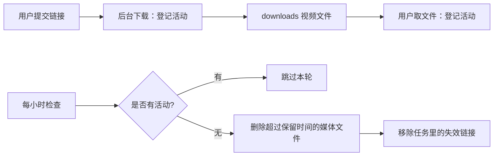

# 个人视频下载工具

支持 **抖音** 与 **B 站（bilibili）** 无水印视频下载，提供命令行（CLI）与 Web 两种使用方式。
既能在本机跑，也能用 Docker 部署到服务器对外提供服务（见 [DEPLOY.md](DEPLOY.md)）。

- **抖音**：Playwright 驱动浏览器（本机用系统 Edge，容器/服务器用 Chromium）拦截详情接口，绕过反爬签名，直接获取无水印直链。
- **B 站**：纯 `requests` + wbi 签名，无需浏览器，支持多分 P 与 1080P 高清（需登录态 + ffmpeg）。
- **Web**：FastAPI 服务，含访问鉴权、任务持久化（SQLite）、并发限流与受控文件下载。

---

## 功能特性

### 通用
- **配置外置**：端口、目录、并发、浏览器引擎全部走环境变量 / `.env`，同一份代码适配本机与服务器
- **任务持久化**：SQLite 存储任务、进度与日志，服务重启数据不丢；启动时自动把中断的任务标记为失败
- **并发限流**：`MAX_CONCURRENCY` 控制同时下载数，排队超过 `QUEUE_LIMIT` 返回 `429`；入参有长度与数量上限
- **磁盘保护**：剩余空间低于 `MIN_FREE_MB` 时拒绝新任务
- **访问鉴权（可选）**：设置 `ACCESS_TOKEN` 后所有页面与接口都需登录；文件下载带归属校验，防越权与路径穿越
- **健康检查**：`/healthz` 返回磁盘容量、排队数与并发配置

### 抖音（downloader.py）
- 无水印视频下载（只取 `play_addr` 系，避开带 `watermark=1` 的 `download_addr`）
- 支持多种输入：分享链接、口令文本、纯视频 ID（15~20 位数字）
- 短链（`v.douyin.com`）自动跳转解析
- 浏览器引擎可切换：`msedge`（本机首选，反爬识别率低）/ `chromium`（容器与服务器默认选项）
- 失败时可用 **yt-dlp** 兜底，支持从浏览器读取 cookie（`edge` / `chrome`）

### B 站（bilibili.py）
- 解析 BV 号 / av 号 / `b23.tv` 短链 / 完整链接
- 获取标题、UP 主、分 P 列表，支持按页码下载指定分 P 或全部
- 默认下载 ≤720P 的 mp4 直链（单文件，无需 ffmpeg）
- `--hd` 下载 1080P（DASH 音视频分离，ffmpeg 合并，需登录 cookie + ffmpeg）

### Web（app/）
- FastAPI + Jinja2 页面，提交链接即创建后台任务，实时显示进度条与日志
- 任务卡片支持日志展开、过滤、文件下载；前端含平台自动识别与 XSS 转义
- 全部接口受访问口令保护（未启用口令时自动关闭鉴权）

---

## 目录结构

```
dyonline/
├── app/
│   ├── __init__.py
│   ├── auth.py            # 访问鉴权：中间件 + 白名单 + HttpOnly Cookie
│   ├── config.py          # 配置中心：环境变量 > .env > 默认值
│   ├── main.py            # FastAPI 应用入口、路由、并发控制
│   └── task_store.py      # 任务仓库：SQLite 持久化（对外接口与方法签名保持稳定）
├── static/
│   ├── app.js             # 前端逻辑（提交 / 轮询 / 渲染 / 通知）
│   └── style.css          # 前端样式
├── templates/
│   ├── index.html         # 下载台首页
│   └── login.html         # 登录页
├── data/                  # 运行期数据（SQLite 库，自动创建，不入库）
├── downloads/             # 下载文件保存目录（自动创建，不入库）
├── bilibili.py            # B 站下载模块
├── downloader.py          # 抖音下载模块 + CLI 入口
├── requirements.txt       # Python 依赖清单
├── .env.example           # 配置模板（复制成 .env 使用）
├── Dockerfile             # 生产镜像定义
├── docker-compose.yml     # 一键部署编排（应用 + Caddy + 数据卷）
├── Caddyfile              # 8080 → app:8000 反向代理
├── DEPLOY.md              # 部署指南（含排障与安全清单）
└── README.md
```

---

## 环境要求

- **Python** 3.10+
- **浏览器**：Windows 默认 Edge；Linux 容器默认 Playwright Chromium。可用 `DOUYIN_BROWSER_CHANNEL` 指定。
- **ffmpeg**（仅 B 站 1080P 高清下载需要，需加入系统 PATH）
- **Docker**（可选）：服务器容器部署使用。

---

## 安装

```bash
# 1.（推荐）创建并激活虚拟环境
python -m venv .venv
.venv\Scripts\activate        # Windows

# 2. 安装依赖
pip install -r requirements.txt

# 3. 安装 Playwright 浏览器驱动（本机用系统 Edge 时无需下载 chromium）
playwright install msedge
```

---

## 配置

复制配置模板后按需修改（`.env` 已被 gitignore 忽略，不会进仓库）：

```bash
cp .env.example .env
```

| 变量 | 默认值 | 说明 |
|------|--------|------|
| `HOST` / `PORT` | `127.0.0.1` / `8000` | 监听地址与端口，服务器上改为 `0.0.0.0` |
| `ACCESS_TOKEN` | 空 | **访问口令**。留空 = 关闭鉴权（仅本机开发）；公网部署**必须设置** |
| `COOKIE_SECURE` | `false` | 走 HTTPS 时设为 `true`；本地 HTTP 下必须为 `false`，否则登录状态无法保持 |
| `MAX_CONCURRENCY` | `2` | 同时下载的任务数（每个无头浏览器约占 150–300MB 内存） |
| `QUEUE_LIMIT` | `20` | 排队上限，超出返回 `429` |
| `MAX_LINKS_PER_TASK` | `20` | 单个任务的链接数上限 |
| `MIN_FREE_MB` | `2048` | 磁盘剩余空间低于此值拒绝新任务 |
| `DOUYIN_ENGINE` | Windows: `msedge`；Linux: `chromium` | 抖音浏览器引擎：`msedge`（本机）/ `chromium`（容器与服务器） |
| `DOUYIN_COOKIE` | 空 | 注入抖音登录态（容器/服务器上无法用 `--cookies-from-browser`） |
| `BILI_COOKIE` | 空 | B 站登录态（`SESSDATA=xxx`），下载 1080P 需要 |
| `DOWNLOAD_DIR` / `DATA_DIR` / `DB_PATH` | 项目内 `downloads/`、`data/` | 数据与文件路径，容器部署时由卷挂载覆盖 |

配置优先级：**真实环境变量 > 项目根目录 `.env` > 代码内默认值**。

---

## 使用方法

### 方式一：命令行（CLI）

```bash
python downloader.py "分享链接或口令"
```

支持一次传入多个链接（自动区分抖音与 B 站）：

```bash
python downloader.py -o D:/downloads "链接1" "链接2" ...
```

**抖音相关参数：**

```bash
# 失败时用 yt-dlp 从 Edge 读取 cookie 兜底
python downloader.py --cookies-from-browser edge "链接"

# 强制使用 yt-dlp 下载
python downloader.py --yt-dlp --cookies-from-browser edge "链接"

# 指定浏览器引擎（容器/服务器上用 chromium）
python downloader.py --engine chromium "链接"
```

**B 站相关参数：**

```bash
# 下载指定分 P（页码，从 1 开始）或 ALL（全部）
python downloader.py --p 2 "BV1xxxx"

# 下载 1080P 高清（需登录 cookie + 本机安装 ffmpeg）
python downloader.py --hd --cookie "SESSDATA=xxx" "BV1xxxx"
```

完整参数列表：

| 参数 | 说明 |
|------|------|
| `links` | 分享链接/口令，可一次给多个 |
| `-o, --output` | 保存目录（默认当前目录） |
| `--cookies-from-browser` | 抖音失败时用 yt-dlp 从浏览器读 cookie 兜底（如 `edge`/`chrome`） |
| `--yt-dlp` | 抖音强制使用 yt-dlp 下载 |
| `--engine` | 抖音：浏览器引擎 `msedge` 或 `chromium` |
| `--p` | B 站：选择分 P（页码数字或 `ALL`，默认全部） |
| `--hd` | B 站：下载 1080P 高清（DASH + ffmpeg） |
| `--cookie` | B 站：传登录 Cookie（如 `SESSDATA=xxx`） |

### 方式二：Web 服务

**一键启动（本机推荐）**：双击根目录 `start.bat`，脚本会自动完成「创建虚拟环境 → 安装依赖 → 启动服务 → 打开浏览器」。

手动启动：

```bash
uvicorn app.main:app --reload
```

浏览器访问：<http://127.0.0.1:8000>

- 若 `.env` 中设置了 `ACCESS_TOKEN`，会先跳转登录页，输入口令后进入下载台
- 首页粘贴链接（每行一个），提交后创建后台任务，实时显示进度条、日志与文件下载链接
- 顶栏「退出」按钮可清除登录状态

---

## 部署到服务器（Docker）

最简流程（完整步骤见 [DEPLOY.md](DEPLOY.md)）：

```bash
git clone https://github.com/qhanqing98-cyber/dyonline.git && cd dyonline
cp .env.example .env     # 填好 ACCESS_TOKEN / MAX_CONCURRENCY，并设置 DOUYIN_ENGINE=chromium
docker compose up -d --build
```

访问 `http://服务器地址:8080`，由 Caddy 代理 app:8000；HTTP 入口设置 `COOKIE_SECURE=false`。

> ⚠️ 部署前**务必**设置 `ACCESS_TOKEN`，否则任何人都能使用你的服务器下载。

---

## HTTP 接口

除 `/healthz` 外，所有接口在启用鉴权后都需要登录（携带 Cookie）。

| 方法 | 路径 | 说明 |
|------|------|------|
| `GET` | `/` | 下载台首页（未登录时 302 跳转登录页） |
| `GET` | `/login` | 登录页 |
| `POST` | `/api/login` | 校验口令，成功后下发 HttpOnly Cookie |
| `POST` | `/api/logout` | 退出登录，清除 Cookie |
| `POST` | `/api/tasks` | 创建下载任务，请求体 `{"links": ["链接1", "链接2"]}` |
| `GET` | `/api/tasks` | 列出所有任务 |
| `GET` | `/api/tasks/{task_id}` | 查询单个任务的进度、日志、产出文件 |
| `GET` | `/api/tasks/{task_id}/files/{filename}` | 下载该任务产出的文件（带归属校验，防越权与路径穿越） |
| `GET` | `/healthz` | 探活与运行状态（免登录，给反向代理/监控用） |

---

## 实现原理

### 抖音
1. 解析分享链接/口令，提取 `aweme_id`。
2. Playwright 无头启动浏览器打开作品页，收到页面响应后独立等待视频数据；遇到登录或验证码时可能失败。
3. 拦截详情接口 `/aweme/v1/web/aweme/detail/` 的响应，从 `aweme_detail.video.play_addr.url_list` 取无水印直链。
4. 用 `requests` 带 `Referer` 流式下载到本地。

### B 站
1. 解析 BV/av 号（b23.tv 短链自动跳转）。
2. `view` 接口获取标题、UP 主、分 P 列表（每 P 的 cid）。
3. `playurl` 接口（wbi 签名）获取播放地址：
   - 默认（≤720P）：`fnval=0` 返回 `durl` → mp4 单文件直链，直接下载。
   - `--hd`（1080P）：`fnval=16` 返回 `dash`（音视频分离）→ ffmpeg 合并。

### Web
1. `POST /api/tasks` 校验入参、检查队列余量后写入 SQLite，并提交到线程池。
2. 后台线程按平台分流下载，通过回调把进度与日志回写任务仓库（进度写入带节流）。
3. 前端每 1.5s 轮询活跃任务，按内容指纹去重渲染，避免无谓重绘。

---

## 注意事项

- 本工具仅供个人学习、研究及备份自己拥有权限的内容使用，请遵守目标平台的服务条款与当地法律法规，勿用于任何商业或侵权用途。
- **公网部署必须设置 `ACCESS_TOKEN`**，否则等同于把服务器对外开放。
- 抖音下载依赖浏览器：本机需要系统 Edge；容器/服务器上用 `chromium`（镜像内已装）。
- B 站 1080P 高清下载需登录 Cookie（`SESSDATA` 等）且本机已安装 ffmpeg。
- 下载的文件统一保存在 `downloads/` 目录（或 `-o` 指定的目录），同名文件会自动跳过。


## 服务器视频定期清理

Web 服务默认保留下载文件 **24 小时**，**每小时检查一次**，第一次检查在启动一小时后进行。
年龄按文件最后修改时间计算，所以重启后仍能清理之前留下的视频和失败下载的媒体临时文件。
实际删除可能比保留时间晚一个检查周期；有后台下载或 `/api/tasks/{id}/files/{name}` 文件传输时，本轮跳过，下轮重试。
清理仅针对 `downloads/` 顶层的 `.mp4`、`.m4s`、`.webm`、`.m4a`、`.part`、`.ytdl` 文件，
不递归删除目录，不跟随符号链接，不清理其他扩展名。
任务记录和日志保留；已删除文件名从 API 返回中移除，已打开的页面需要刷新。

| 环境变量 | 默认值 | 作用 |
|---|---|---|
| `DOWNLOAD_RETENTION_HOURS` | `24` | 非负整数小时；`0` 关闭自动清理 |
| `DOWNLOAD_CLEANUP_INTERVAL_SECONDS` | `3600` | 正整数秒，控制检查间隔 |

Linux 启动示例（保留 48 小时）：

```bash
DOWNLOAD_RETENTION_HOURS=48 DOWNLOAD_CLEANUP_INTERVAL_SECONDS=3600 \
uvicorn app.main:app --host 127.0.0.1 --port 8000 --workers 1
```

任务由 SQLite 持久化；下载队列和清理保护在进程内，服务器使用 **一个 worker、一个应用实例**。
多个实例或 CLI 不应同时向这个受清理的目录写文件。清理由应用自行调度，无需额外安装 cron。
Caddy 应将受控文件下载接口也反向代理给本应用，避免直接读取下载目录而绕过传输保护。




## Caddy：8080 对外，代理 app 容器的 8000

仓库的 `Caddyfile` 核心路由如下（另保留压缩、请求体限制及传输超时）：

```caddyfile
:8080 {
    reverse_proxy app:8000
}
```

- `:8080`：Caddy 在 8080 端口接收 HTTP 请求。
- `reverse_proxy app:8000`：将所有路径（首页、API、静态资源、视频文件）转发给 `app` 容器的 8000 端口。
- Caddy 容器与 `app` 容器必须连接同一个 Docker 网络，`app` 为服务名或网络别名。
- app 容器内启动命令：`uvicorn app.main:app --host 0.0.0.0 --port 8000 --workers 1`。
- Caddy 容器端口映射：`8080:8080`；将此文件挂载到 `/etc/caddy/Caddyfile`。
- app 的 8000 端口供容器网络访问，无需映射到公网。
- 在 app 容器设置上述清理环境变量，并确保挂载的下载目录允许应用删除文件。

若 Caddy 运行在宿主机上，则将 app 的端口映射为 `127.0.0.1:8000:8000`，
并将代理目标改为 `127.0.0.1:8000`。

更新服务器配置前可在 Caddy 容器运行：

```bash
caddy validate --config /etc/caddy/Caddyfile --adapter caddyfile
caddy reload --config /etc/caddy/Caddyfile --adapter caddyfile
```

本仓库的 `docker-compose.yml` 已映射 Caddy 的 `8080:8080`，app 容器内监听 8000。
语法参考：https://caddyserver.com/docs/caddyfile/directives/reverse_proxy


## 抖音容器排查：Page.goto 超时

出现 `Page.goto: Timeout ... waiting until "domcontentloaded"` 表示浏览器已启动，
但导航没有在规定时间达到该加载阶段，不能仅凭此错误认定缺少浏览器或触发验证码。
当前实现改用 `wait_until="commit"`（收到页面响应、开始加载文档），然后单独等作品详情。
即使导航超时也尝试使用已经收到的数据；失败时记录页面状态、关键请求错误和标题。
`blob:` 视频地址不交给 requests 下载，因为它只在浏览器内有效。

| 环境变量 | 默认值 | 作用 |
|---|---|---|
| `DOUYIN_BROWSER_CHANNEL` | Windows: `msedge`；Linux: `chromium` | 选择已安装的浏览器 |
| `DOUYIN_NAVIGATION_TIMEOUT_MS` | `30000` | 正整数毫秒，等待页面初始响应 |
| `DOUYIN_MEDIA_TIMEOUT_MS` | `30000` | 正整数毫秒，单独等待视频数据 |

在 Linux 镜像构建期间，安装 Python 依赖后安装浏览器及系统依赖：

```dockerfile
RUN python -m playwright install --with-deps chromium
```

安装与运行需要使用一致的 Playwright 版本，并确保运行用户能够访问浏览器安装目录。
安装方式参考：https://playwright.dev/python/docs/browsers

服务器上先检查 app 容器到抖音的网络（按实际容器名称替换 `app`）：

```bash
docker exec app python -c "import requests; r=requests.get('https://www.douyin.com/', timeout=20); print(r.status_code)"
```

这个检查仅验证 requests 到首页的连接，HTTP 200 也不能证明 Chromium 能拿到视频详情。
若提示 DNS、连接超时或证书错误，先处理容器出口网络；若浏览器日志出现登录/验证页面，
需要进一步确认平台访问要求。Caddy 的 8080→8000 是用户访问本应用的入口，
抖音抓取则由 app 容器直接向外请求。
Web 入口当前没有启用 `cookies_browser`，所以不会自动通过本机浏览器 Cookie 启用 yt-dlp 兜底。

## 已知限制

- **抖音在容器/服务器上可能被风控**：平台对无头浏览器的识别较严，接口可能返回空数据。
  本机走系统 Edge 的成功率最高；服务器上建议只对外开放 B 站功能（详见 `DEPLOY.md`）。
- **必须单 worker 运行**：任务队列与并发计数是进程私有的，`uvicorn --workers N` 会导致队列分叉；
  要提升吞吐请调大 `MAX_CONCURRENCY`。
- **访问鉴权是单共享口令**，不是多用户账号体系：所有使用者共用同一口令、看到同一批任务。


## 运维日志

Web 服务输出单行 JSON 日志，由 Docker 收集。`LOG_LEVEL` 默认 `INFO`。
可按 `request_id` 追踪一次请求，按 `task_id` 追踪后台下载；网页任务日志继续存 SQLite。
Caddy 访问日志已开启；两种容器均按每个文件 10MB、最多 3 个轮转。
查看与排错步骤见 [DEPLOY.md 的运维日志部分](DEPLOY.md#九运维日志)。

```bash
docker compose logs --no-log-prefix --since 30m --tail 200 -f app
```
