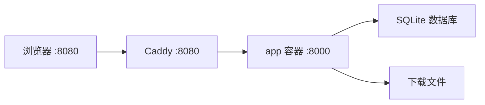
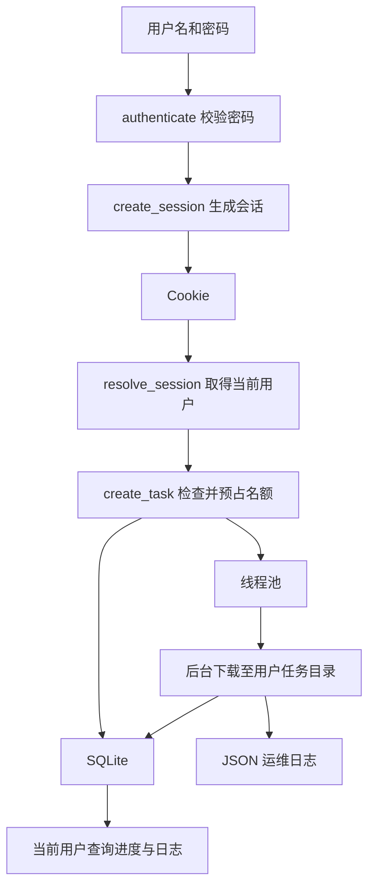

# DY·ONLINE

抖音与 B 站视频下载工具，提供命令行和 Web 两种入口。Web 支持独立账号、任务隔离、SQLite 持久化、任务数量限制、媒体定期清理和 JSON 运维日志。

抖音通过 Playwright 浏览器获取作品详情；B 站通过 `requests` 与 wbi 签名获取播放地址。平台登录、验证码和网络限制可能导致下载失败，不保证所有链接均可下载。

## 快速开始

### Windows 本机运行

需要 Python 3.10+。下载抖音视频时，默认使用已安装的 Microsoft Edge。

在项目目录执行 PowerShell 命令：

```powershell
python -m venv .venv
.\.venv\Scripts\python.exe -m pip install -r requirements.txt
Copy-Item .env.example .env

# 创建首个管理员；按提示输入两次密码
.\.venv\Scripts\python.exe -m app.users create admin --admin

# 启动服务
.\.venv\Scripts\python.exe -m uvicorn app.main:app --host 127.0.0.1 --port 8000 --workers 1
```

浏览器访问 <http://127.0.0.1:8000>，用刚创建的用户名和密码登录。粘贴视频链接，每行一个，提交后可查看任务进度、日志和文件下载链接。

完成配置和账号创建后，也可以双击 `start.bat`，由脚本安装依赖并启动网站。首次运行没有账号时，网站仍要求登录，不会自动开放访问。

Linux 本机使用虚拟环境中的 Python 执行相同模块；抖音浏览器设为 `DOUYIN_ENGINE=chromium`，并安装浏览器依赖：

```bash
python -m playwright install --with-deps chromium
```

### Docker 服务器部署

在服务器项目目录执行：

```bash
cp .env.example .env
# 编辑 .env，设置 ADMIN_PASSWORD，并将 DOUYIN_ENGINE 改为 chromium

docker compose up -d --build
docker compose ps
```

初始配置示例：

```dotenv
ADMIN_USERNAME=admin
ADMIN_PASSWORD=替换为你的初始管理员密码
DOUYIN_ENGINE=chromium
COOKIE_SECURE=false
MAX_CONCURRENCY=2
QUEUE_LIMIT=20
USER_QUEUE_LIMIT=3
```

没有任何账号时，首次启动会用上述配置创建管理员。访问 `http://服务器地址:8080`，输入管理员用户名和密码。



Caddy 对外监听 8080，代理 `app:8000`。app 的 8000 只映射到宿主机回环地址，不对公网开放。当前入口为 HTTP；通过 HTTPS 访问时再设置 `COOKIE_SECURE=true`。

完整安装、备份、升级及排障步骤见 [部署说明](DEPLOY.md)。

## 账号由谁创建

目前不开放注册，也没有网页账号管理入口。**有服务器操作权限的管理员使用命令创建账号**，再把网站地址、用户名和密码交给使用者。仅在网站登录 admin，不能创建其他账号。

### 创建普通账号

```bash
docker compose exec app python -m app.users create alice
```

按提示输入两次密码，输入内容不会显示。用户名为 3–32 位字母、数字、点、下划线或连字符；密码为 8–256 个字符。

### 查看账号、重置密码

```bash
docker compose exec app python -m app.users list
docker compose exec app python -m app.users reset-password alice
```

重置密码会撤销该用户全部会话，需重新登录。网页“退出”只撤销当前会话。

如果首次部署没有配置 `ADMIN_PASSWORD`，可在已运行的容器中创建管理员：

```bash
docker compose exec app python -m app.users create admin --admin
# 分配旧任务需要在创建首个管理员后重启 app
docker compose restart app
```

本机管理账号时，把 `docker compose exec app python` 替换为虚拟环境中的 Python，例如 `.\.venv\Scripts\python.exe`。

`ADMIN_USERNAME`、`ADMIN_PASSWORD` 只用于首次创建账号，修改它们不会重置已有密码。旧部署未设置 `ADMIN_PASSWORD` 时，会以 `ACCESS_TOKEN` 的值作为初始管理员密码；旧 Cookie 失效，需改用用户名和密码登录。

## 用户隔离与任务限制

每个用户只能查看自己的任务、日志和文件，管理员也遵守相同的任务归属检查。访问他人的任务或文件统一返回 404。

用户身份从服务端会话读取，前端传入的 `user_id` 不参与任务归属判断。新文件按以下结构存放，避免不同任务的同名文件覆盖：

```text
downloads/
└── 用户ID/
    └── 任务ID/
        └── 视频.mp4
```

升级时，无归属的旧任务自动分配给第一个管理员，旧文件保留在下载目录顶层。没有管理员时，旧任务保持隐藏；创建管理员并重启后完成分配。

| 限制 | 默认值 | 含义 |
|---|---|---|
| `MAX_CONCURRENCY` | `2` | 同时执行下载的任务数 |
| `QUEUE_LIMIT` | `20` | 所有用户排队中 + 下载中的任务总数上限 |
| `USER_QUEUE_LIMIT` | `3` | 单用户排队中 + 下载中的任务数上限 |
| `MAX_LINKS_PER_TASK` | `20` | 一个任务可提交的链接数量 |

达到用户或全局上限后，继续提交返回 429，页面显示原因。成功、失败、磁盘拒绝以及创建或提交异常都会释放名额。管理员同样受限；用户达到自己的上限时，其他用户仍可使用剩余全局名额。

这些限制按任务计数，不按链接计数。目前未实现每用户存储额度或公平调度。

## 命令行下载

CLI 无需网站账号，独立运行，不经过 Web 的任务限制和任务仓库。默认保存到当前目录，使用 `-o` 指定其他位置：

```bash
python downloader.py -o ./cli-downloads "链接1" "链接2"
```

常用选项：

| 参数 | 用途 |
|---|---|
| `-o, --output` | 保存目录，默认当前目录 |
| `--engine chromium` | 抖音使用 Playwright Chromium |
| `--cookies-from-browser edge` | 抖音失败时用 yt-dlp 从本机浏览器读取 Cookie 兜底 |
| `--yt-dlp` | 抖音直接使用 yt-dlp |
| `--p 2` / `--p ALL` | B 站指定分 P 或下载全部，默认全部 |
| `--hd` | B 站下载高清 DASH 音视频并合并 |
| `--cookie` | B 站登录 Cookie |

```bash
python downloader.py --engine chromium "抖音链接"
python downloader.py --yt-dlp --cookies-from-browser edge "抖音链接"
python downloader.py --p 2 "B站链接"
python downloader.py --hd --cookie "SESSDATA=替换为有效值" "B站链接"
```

B 站默认走最高 720P 的单文件下载；高清需要平台登录态和 PATH 中可用的 ffmpeg。上面的分 P、高清和浏览器 Cookie 选项属于 CLI，网页没有提供这些选项。

Web 不会自动读取本机浏览器 Cookie，也没有启用基于 `cookies_browser` 的 yt-dlp 兜底。服务器平台登录态通过 `DOUYIN_COOKIE`、`BILI_COOKIE` 统一配置，暂不支持每用户独立平台 Cookie。

## 配置

配置优先级为：**真实环境变量 > 项目根目录 `.env` > 代码默认值**。模板见 [.env.example](.env.example)。以下为代码默认值，复制模板后应按实际环境调整。

| 变量 | 默认值 | 说明 |
|---|---|---|
| `ADMIN_USERNAME` | `admin` | 首次创建的管理员用户名 |
| `ADMIN_PASSWORD` | 空；回退旧 `ACCESS_TOKEN` | 初始管理员密码，仅没有账号时使用 |
| `ACCESS_TOKEN` | 空 | 兼容旧部署，不再作为共享登录口令 |
| `COOKIE_NAME` | `dy_token` | 会话 Cookie 名称 |
| `COOKIE_MAX_AGE` | `2592000` | 会话有效期，单位秒，默认 30 天 |
| `COOKIE_SECURE` | `false` | HTTPS 访问时设为 true；HTTP 使用 false |
| `LOG_LEVEL` | `INFO` | DEBUG / INFO / WARNING / ERROR / CRITICAL |
| `MAX_CONCURRENCY` / `QUEUE_LIMIT` / `USER_QUEUE_LIMIT` | `2` / `20` / `3` | 下载并发及全局、单用户未结束任务上限 |
| `MAX_LINKS_PER_TASK` / `MAX_LINK_LEN` | `20` / `2048` | 每任务链接数及单条输入字符上限 |
| `MIN_FREE_MB` | `2048` | 开始任务时的剩余磁盘空间下限，单位 MB |
| `DOUYIN_ENGINE` | Windows: `msedge`；其他系统: `chromium` | 抖音浏览器引擎 |
| `DOUYIN_BROWSER_CHANNEL` | 未设置 | 兼容覆盖项，优先于 `DOUYIN_ENGINE`；CLI `--engine` 优先级更高 |
| `DOUYIN_COOKIE` / `BILI_COOKIE` | 空 | 服务端统一使用的平台登录态 |
| `DOUYIN_NAVIGATION_TIMEOUT_MS` | `30000` | 抖音初始页面响应等待时间，单位毫秒 |
| `DOUYIN_MEDIA_TIMEOUT_MS` | `30000` | 抖音作品数据等待时间，单位毫秒 |
| `DOWNLOAD_DIR` | 项目内 `downloads/` | Web 下载根目录 |
| `DATA_DIR` / `DB_PATH` | `data/` / `data/app.db` | 运行数据目录及 SQLite 数据库 |
| `DOWNLOAD_RETENTION_HOURS` | `24` | 媒体保留小时数，0 关闭自动清理 |
| `DOWNLOAD_CLEANUP_INTERVAL_SECONDS` | `3600` | 清理检查间隔，单位秒 |

无效日志级别回退 INFO 并记录警告；无效或小于 1 的 `USER_QUEUE_LIMIT` 回退 3。修改容器环境配置后，需要重新创建 app 容器生效：

```bash
docker compose up -d --build app
```

`HOST`、`PORT` 是配置项；手动启动 Uvicorn 时实际监听地址以启动参数为准。仓库 Docker 启动命令固定监听 `0.0.0.0:8000`。

## 视频定期清理

默认保留媒体 24 小时，每小时检查一次，第一次检查在启动一小时后进行。文件年龄按最后修改时间计算，实际删除可能晚于保留时间；服务忙碌时会继续延后。

- 有后台下载或文件传输时，整轮清理跳过。
- 同时检查下载目录顶层的旧文件和服务生成的两层 UUID 用户/任务目录。
- 只删除过期的 `.mp4`、`.m4s`、`.webm`、`.m4a`、`.part`、`.ytdl` 文件，不跟随符号链接、不删除目录。
- 保留任务与日志，从任务文件列表移除已删除文件；已打开的页面需要刷新。

不要让独立 CLI 或其他应用同时向 Web 的受清理目录写入文件。清理由应用线程调度，不需要额外配置 cron。

## 运维日志

应用日志采用单行 JSON 输出到标准输出，由 Docker 收集；网页任务日志继续存 SQLite，每任务最多 500 条。

| 字段 | 用途 |
|---|---|
| `request_id` | 关联一次请求；正常响应头包含 `X-Request-ID` |
| `task_id` | 关联任务创建及后台下载过程 |
| `user_id` | 关联当前用户及后台任务 |
| `event` | 区分请求、任务、清理、外部工具和拒绝事件 |

异常记录脱敏后的堆栈；配置口令、Cookie、Authorization、URL 用户信息和查询值共用脱敏。Caddy 访问日志去掉 URI 查询串及请求、响应头字段。未处理异常继续交给框架，异常 500 响应不保证带 `X-Request-ID`。

在服务器项目目录查看：

```bash
# 最近 30 分钟应用日志，显示最多 200 条并实时跟踪
docker compose logs --no-log-prefix --since 30m --tail 200 -f app

# Caddy 访问日志
docker compose logs --no-log-prefix --since 30m --tail 200 caddy

# 替换为真实任务 ID；也可替换为请求 ID 或用户 ID
docker compose logs --no-log-prefix --since 24h app | grep -F '任务ID'
```

`--no-log-prefix` 保持每行可独立解析的 JSON；`-f` 持续跟踪，Ctrl+C 只退出查看，不停止服务。

正常探活和静态资源访问仅在应用 DEBUG 级别记录；Caddy 仍记录访问日志。用户达到任务上限时记录 `user_queue_rejected`。yt-dlp 服务输出接入任务日志并减少重复进度，ffmpeg 失败保留脱敏 stderr 末尾最多 8KB。

app 和 Caddy 均采用 Docker `json-file`，单文件 `10m`，最多 `3` 个。容量轮转不保证固定保留天数，删除或重建容器可能丢失历史日志；SQLite 数据由 `data/` 挂载保存。

## HTTP 接口

业务接口需要会话 Cookie。登录页、登录接口、探活及静态资源公开。

| 方法 | 路径 | 说明 |
|---|---|---|
| GET | `/` | 下载台，未登录跳转登录页 |
| GET | `/login` | 用户名与密码登录页 |
| POST | `/api/login` | 请求体 `{"username":"alice","password":"..."}` |
| POST | `/api/logout` | 撤销当前会话并清除 Cookie |
| GET | `/api/me` | 当前用户信息，不含密码或会话凭证 |
| POST | `/api/tasks` | 请求体 `{"links":["链接1","链接2"]}`；身份由服务端填写 |
| GET | `/api/tasks` | 当前用户的任务列表 |
| GET | `/api/tasks/{task_id}` | 当前用户任务的进度、日志和文件 |
| GET | `/api/tasks/{task_id}/files/{filename}` | 归属检查后的文件下载 |
| GET | `/healthz` | 磁盘、全局未结束任务数及并发配置 |

常见响应：401 表示未登录或会话失效，404 表示任务不存在或不属于当前用户，429 表示用户或全局任务名额已满。

## 代码与数据流

```text
app/
├── config.py          环境配置与默认值
├── users.py           用户、密码散列、服务端会话和账号管理命令
├── auth.py            会话鉴权及请求用户绑定
├── main.py            路由、线程池、用户与全局任务名额
├── task_store.py      SQLite 任务、日志及文件列表
├── cleanup.py         定期清理与文件使用保护
└── logging_setup.py   JSON 日志、脱敏和请求上下文
bilibili.py            B 站下载
downloader.py        抖音下载与 CLI 入口
static/               页面脚本及样式
templates/            登录页与下载台
```



几个值得读的函数：

- `hash_password()` 使用随机盐值和 PBKDF2-SHA256，数据库不保存明文密码。
- `resolve_session()` 从数据库查询未过期的会话；`AuthMiddleware.__call__()` 将身份放入 `request.state.user`。
- `create_task()` 在一把锁内检查用户与全局计数，防止同时提交突破限制；`_release_slot()` 回收两种名额。
- `TaskStore.get(..., user_id=...)` 和 `all(user_id=...)` 在 SQL 查询阶段限定归属。
- `task_directory()` 构建文件目录；`cleanup_once()` 清理过期媒体并移除失效链接。
- `log_context()` 绑定日志关联信息，退出时恢复；提交线程池时使用 `copy_context()` 传递上下文。

`?` 是 SQLite 参数占位符，值单独传入；`with self.lock, self.conn:` 管理线程互斥和数据库事务。
网站用户不是操作系统用户：不同账号仍共享同一个服务进程，归属检查控制数据访问，目录分开解决文件覆盖，锁解决并发计数。

## 限制与排障

- **保持单 worker、单应用实例。** 队列计数、线程池和清理保护在进程内；增加 worker 会使限制失去全局一致性。
- **抖音可能受平台风控。** 当前导航先等待 `commit`，再独立等待作品数据。首页返回 HTTP 200 不代表能获取视频详情，应结合日志中的阶段、网络错误和页面状态排查。
- **资源仍然共享。** 每用户任务上限可以防止单账号占满默认队列，但尚无公平调度、存储额度或个人平台 Cookie。
- **账号由服务器命令管理。** 暂无自助注册和网页账号管理。
- **旧日志不会批量脱敏改写。** 新增脱敏只覆盖之后写入的消息，升级前的敏感历史记录需要另行处理。

具体故障处理、数据库迁移与备份步骤见 [部署说明](DEPLOY.md)。仅下载自己有权保存的内容，并遵守目标平台条款。

## 版本控制

`.gitignore` 排除环境配置、运行数据库、媒体、备份、虚拟环境、本地测试与开发产物，`.env.example` 保留在仓库。
本地 `tests/` 不纳入 Git，也由 `.dockerignore` 排除。已跟踪文件不会因为新增忽略规则自动退出版本控制。
